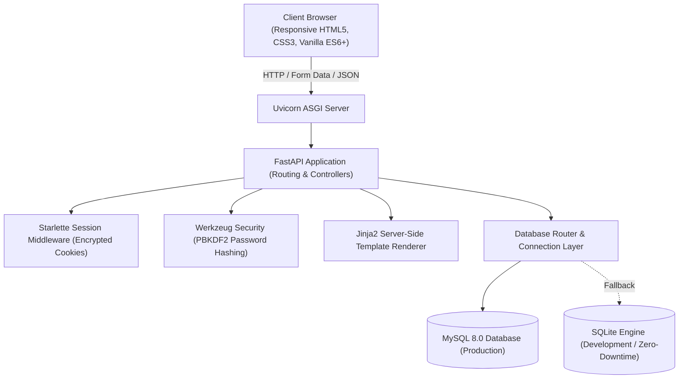
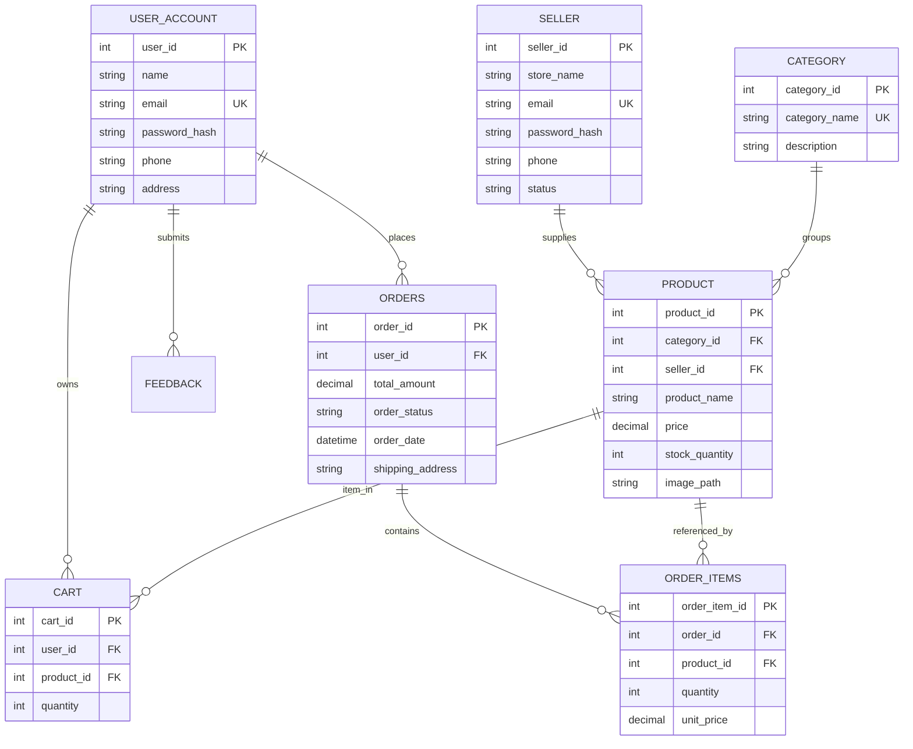

# FreshCart - System Architecture & Engineering Specifications

## 1. High-Level Architecture

FreshCart is built as a high-performance web application utilizing **FastAPI**, an asynchronous Python ASGI web framework, combined with server-rendered Jinja2 templates and a relational persistence layer.

---

## 2. Relational Data Model (ER Diagram)

---

## 3. Security & Data Integrity

1. **Password Encryption**: All customer, seller, and administrator passwords are encrypted via `werkzeug.security.generate_password_hash` using PBKDF2 with SHA-256 HMAC and random salts.
2. **Session Security**: Session cookies are signed with an HMAC secret key and configured with `HttpOnly` and `SameSite=Lax` flags to prevent cross-site scripting (XSS) session theft.
3. **Dual-Database Resiliency**: The database layer connects to MySQL via `pymysql` with automated connection timeouts. If MySQL is unreachable, it automatically provisions and switches to SQLite (`app.db`), guaranteeing zero runtime crashes.
